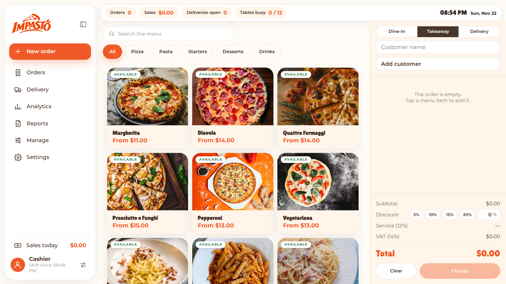

 

  

<h1 align="center">IMPASTO POS — Restaurant Management System</h1>

  <strong>Smarter Operations. Better Experiences.</strong>
   
  The official point-of-sale experience of IMPASTO, designed to bring restaurant operations together through simplicity, efficiency, and elegant design.

---

## About The Project

**IMPASTO POS** is the official restaurant point-of-sale and management system of **IMPASTO**, designed to simplify and organize the restaurant's daily operations.

POS stands for **Point of Sale**, a system used by restaurants to process customer orders, manage sales and payments, track inventory, and handle essential day-to-day operations.

IMPASTO POS brings together practical restaurant management tools in one organized interface. From processing customer orders and managing menu items to monitoring inventory and exploring sales performance, the system provides a centralized platform for managing restaurant operations.

Built around clarity, usability, and efficient workflows, IMPASTO POS combines essential business tools with a refined interface to make restaurant management more organized and intuitive.

## Features

- **Point of Sale** — Create orders, customize products, apply discounts, and manage checkout.
- **Order Management** — Organize restaurant orders and access order details in one place.
- **Table Management** — Manage dine-in tables and organize table orders.
- **Menu Management** — Manage products, categories, prices, and item availability.
- **Inventory Management** — Monitor stock quantities and identify low-stock items.
- **Customer Management** — Organize customer profiles and view order history.
- **Payment Management** — Support different payment workflows, including cash, card, and split payments.
- **Analytics & Reports** — Explore sales performance, popular products, and business insights.
- **Restaurant Settings** — Configure taxes, service charges, tables, and receipt preferences.
- **Modern Dashboard** — A clean and organized interface designed for everyday restaurant workflows.

## Tech Stack

- **HTML5**
- **CSS3**
- **JavaScript**
- **Vercel**

## Demo Notice

IMPASTO POS is a demonstration version of IMPASTO's restaurant management system, created for presentation and portfolio purposes.

The system may use sample data and simulated workflows. Products, orders, customer information, payments, reports, and other displayed information may be intended for demonstration purposes only.

This demo is not designed for processing real financial transactions, storing real customer information, or managing live restaurant operations.

Some features may be limited to demonstration functionality and may not be connected to real external services.

## System Preview

  

## Live Demo

Explore the IMPASTO POS experience:

## Project Vision

The goal behind IMPASTO POS is to provide IMPASTO with a centralized system for managing restaurant operations, combining essential point-of-sale tools with an intuitive user experience.

Designed to make everyday workflows more organized, accessible, and efficient.

## </> Developer

**Developed by [Raed Mosaed](https://github.com/raedmosaed0)**

---

© 2026 IMPASTO. All rights reserved.
